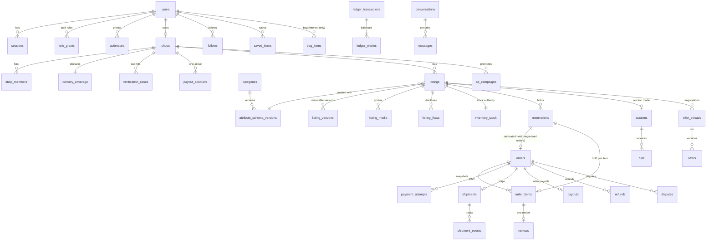

# Entity relationship overview

Full DDL: `packages/database/migrations/0001_core_schema.sql`. Key relationships:

Integrity highlights: stock CHECK invariant; one active reservation per (source, source_id); one live order per
dedicated hold (`orders.reservation_id`, single-hold orders); every order item carries its own hold and a pending
order's holds move together (ADR-0009); bag items never hold stock; one succeeded payment attempt per order; one payout per order; one review per order item; one active
dispute per order; ledger transactions must balance (deferred trigger) and are append-only; audit events append-only.
