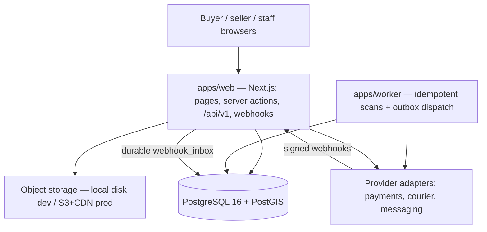
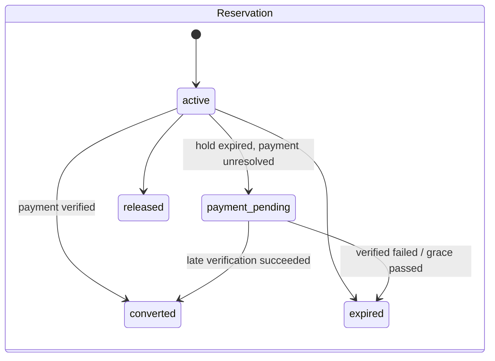
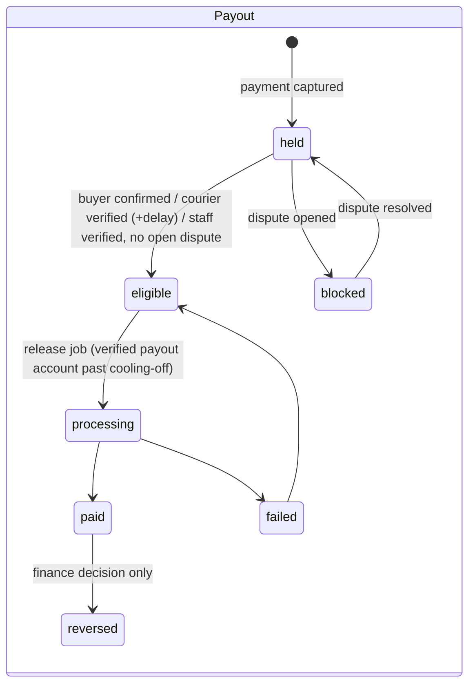

# Architecture overview

Logical topology (ADR-0001). PostgreSQL is authoritative; caches, search results, client state and live views are
projections and are revalidated at checkout.

## Packages and ownership

| Package / module | Owns |
| --- | --- |
| `domain` | Money (kobo), listing publish checklist, stock movement math, offer rules, auction bid/extension rules, state machines, delivery eligibility, reputation scoring, settings defaults. No I/O. |
| `application/core` | Context/actor, authorisation helpers, audit, outbox, idempotency, rate limits, settings, validation, services factory. |
| `application/identity` | Accounts, passwords, sessions, contact verification. |
| `application/inventory` | **The** inventory authority (reserve / release / convert / withdraw / restock). |
| `application/shops`, `catalogue` | Shops, coverage, verification, payout accounts, categories + schema versions, listings, batches, templates. |
| `application/discovery` | Search, home feed, nearby shops, saved/followed reads. |
| `application/checkout`, `payments`, `orders`, `payouts`, `ledger`, `addresses` | Checkout holds, payment attempts, webhook inbox processing, order snapshots, refunds, payouts, double-entry ledger. |
| `application/fulfilment`, `disputes` | Shipments, courier events, delivery confirmation, disputes/returns. |
| `application/messaging`, `offers` | Conversations, messages, offer threads. |
| `application/auctions` | Scheduling, bids, finalisation, winner checkout handoff, second-chance offers. |
| `application/trust`, `growth` | Reviews, reputation, reports/moderation, follows, notifications, consent. |
| `application/ads`, `insights`, `admin` | Promotions, seller metrics, operations console. |
| `providers` | Payment (sandbox, Paystack), courier (sandbox), messaging (sandbox), storage, image processing. |

## Concurrency and money rules

- Lock order: `auctions → offer_threads → inventory_stock → reservations → orders → payment_attempts → payouts`.
- Transactions are short and never call providers. Pattern: record intent → commit → call provider → verify →
  apply in a new guarded transaction. Unknown outcomes become `uncertain` and are reconciled by the worker.
- Every money movement is a balanced, append-only ledger transaction with a unique idempotency key.
- Webhooks: verify signature on the raw body → insert into `webhook_inbox` (unique per provider event) → 200 →
  process inline best-effort → worker retries pending rows.

## State machines (see `packages/domain/src/state-machines.ts`)

Order (`pending_payment → confirmed → completed | cancelled`), payment (`pending → paid → refund_pending →
partially_refunded | refunded`), fulfilment (`unfulfilled → awaiting_dispatch → dispatched/in_transit → delivered`,
with exceptions/returns), dispute and refund machines are separate columns/tables so one never implies another.

## Time

The server stores UTC; Nigerian users see West Africa Time. Auction validity, hold expiry and deadlines are evaluated
with server time read inside the serialising transaction; client countdowns are corrected by the server time sent with
each snapshot and are informational only.
