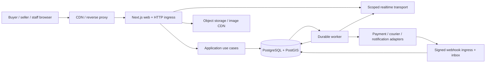
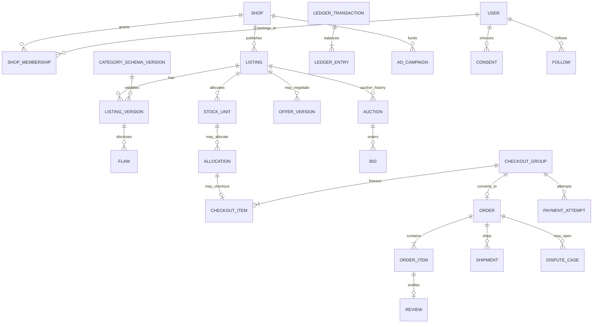

# Architecture, contracts and quality plan

**Status:** design proposal, no code, deployment or provider integration. Framework choice **Next.js** is owner-selected; other technology and commercial choices are recommendations pending ADR/cost review. Requirements and slice IDs refer to documents 01 and 04.

Revision 2: [transaction and data contracts](06-Transaction-and-Data-Contracts.md) refine this outline following a separate planning review. They define cart atomicity, early checkout snapshots, auction custody, offer action rights, payment attempt fences and payout/case races.

## Architecture decisions

| ADR | Recommendation and reason | Alternative / consequence | Decision state |
| --- | --- | --- | --- |
| A01 Web | Next.js App Router + TypeScript for buyer, seller, staff UI and HTTP ingress. Shared domain/application packages stay framework-independent. | Separate API framework adds operations and duplicated contract risk at this stage; revisit if independent clients/team boundaries justify it. | Next.js selected; exact version pending compatibility/security check. |
| A02 Topology | Modular monolith with independently runnable web/API and durable worker; add persistent real-time gateway only when needed by hosting/traffic. | Microservices now add distributed transaction and operational burden. | Proposed. |
| A03 Authority | PostgreSQL transaction boundary owns stock, reservations, accepted offers, auction bid order/winner, order snapshots and financial ledger. PostGIS supports private/approximate location queries. | Cache/search/realtime can lag and may never decide scarce ownership. | Proposed; correctness to prove under overlapping transactions. |
| A04 Media | Signed upload intent, private original storage, moderation/validation, derived public sizes through object storage/CDN. | Direct public uploads and unbounded image serving expose risk/cost. | Proposed; vendor TBD. |
| A05 Jobs/events | Database-backed inbox/outbox, idempotent worker handlers and reconciliation sweeps. Redis is optional for rate limits/fan-out, not durable order truth. | In-process timers or Redis TTL alone lose money/stock decisions on restart. | Proposed. |
| A06 Search | Indexed PostgreSQL text/trigram/category filters first; PostGIS for near-me; measure before adding a search service. | External search improves some relevance workloads but adds sync and cost. | Proposed. |
| A07 Payments | Provider adapter selected only after the actual Nigerian protected-money model is confirmed; no self-declared escrow. | Immediate splits do not establish delayed release; South Africa card holds are not a Nigerian flow. | **Blocked for checkout implementation.** |

### Logical topology

Next.js serves public pages and scoped buyer/seller/staff interactions. Route handlers are thin HTTP boundaries: authenticate, validate, call application use case, map response. Domain rules and transactions live in shared packages callable by both web and worker. Jobs never depend on Next.js-only imports. Each deployment process starts independently and has a health check. Public content can cache, but stock/price/route and permissions are revalidated at mutation. If self-hosted across instances, plan reverse proxy, common deployment identity, cache coordination, image handling and version-skew controls according to [Next.js guidance](https://nextjs.org/docs/app/guides/self-hosting).

### Suggested future repository modules (not created)

`apps/web`, `apps/worker`, optionally `apps/realtime`; `packages/domain`, `packages/application`, `packages/database`, `packages/contracts`, `packages/providers`, `packages/ui`; `tests`; `docs`. These are boundaries, not a mandate for separate packages on day one. Start with the smallest arrangement that preserves worker/web independence.

## Domain ownership and logical ERD

| Domain | Owns | May request from another domain |
| --- | --- | --- |
| Identity/Shops | account, session, role grant, shop membership, public slug, verification case. | Trust approval; payment-beneficiary status. |
| Catalogue | category schema version, listing/version, media, flaw/measurement disclosure, declared sale mode. | Inventory availability projection. |
| Inventory | stock unit/variant, hold, allocation, external sale mark. **Only stock authority.** | Order/order-item creation within same transaction boundary. |
| Offers/Auctions | offer version and negotiation; auction schedule, bid order, close result. | Inventory allocation through one transaction authority. |
| Orders/Payments | immutable order-item snapshot, payment attempt, refund, payout obligation, balanced ledger, reconciliation. | Delivery events and case decisions. |
| Delivery | policy, per-route quote, shipment and source-labelled event/proof. | Payment release request under approved policy. |
| Trust/Growth | review entitlement, reputation, follows/consent, promotion; staff cases/moderation. | Purchase eligibility, catalogue availability. |

### Data constraints to formalise in migrations

- `shop.slug` unique and stable (redirect or explicit rename policy); `membership(shop_id,user_id)` unique; role grants scoped and time-bounded where appropriate.
- `listing` has one published `sale_mode`. `listing_version` is immutable after publication, and paid `order_item` snapshots reference/copy the actual version, media identifiers, fees, shipping terms and policy version. Deletion policy preserves required evidence.
- A `stock_unit` represents one unique piece or a genuinely equivalent variant with quantity. `available >= 0`, `reserved >= 0`, `sold >= 0`, and `available + reserved + sold` reconciles to accepted stock adjustments. Different size/condition pieces are separate units even within a batch.
- An active allocation is exclusive for a one-piece stock unit; quantity allocation updates under row lock/version check. Same-seller cart creates a checkout group and child allocations atomically, all or none. The complete accepted item/media/condition/fee/route/policy snapshot is frozen before provider initiation. An uncertain provider attempt prevents blind release.
- Each auction references one eligible one-piece listing; a listing can have auction history but only one active lifecycle. Scheduled publication acquires exclusive stock custody; close transfers it atomically to a winner obligation. Bid rows append with server sequence/time; seller, shop staff and prohibited related accounts cannot bid. A unique terminal result/winner prevents duplicate close effects.
- `offer_version` records proposer and opposing recipient with monotonic version; only recipient accepts/rejects, proposer withdraws, and a counter supersedes prior terms. Acceptance and allocation are atomic. Pending offers do not reserve stock.
- Provider references, webhook event IDs, command idempotency keys, refund IDs and payout IDs have unique constraints at appropriate scopes. One active/uncertain payment attempt per checkout obligation fences different retry keys. Excess verified charges become refund liabilities. Ledger transactions are append-only and balanced in integer minor units per currency. No mutable “balance” is treated as provider-held cash.
- Reviews require a unique eligible `(order_item_id, reviewer_id)` entitlement; events and moderation preserve prior versions. `ad_placement` cannot mutate trust scores.
- Private address, identity evidence and payout details live behind separate access paths and retention controls. Public geo is rounded/approximate, not an exact home point.

## Authoritative state machines

Transitions below are proposed. Failure and exceptional transitions require versioned policy and actor permission; they must never be direct UI field edits.

| Machine | Main path | Recovery / prohibition |
| --- | --- | --- |
| Listing | draft → review → published → paused/sold/removed | A bid-bearing auction or held/paid item blocks incompatible edits; purchase snapshot remains. |
| Reservation | requested → active → payment-pending → consumed or released | Timer triggers verification; uncertain payment enters reconciliation. Late success becomes case/refund if unit was legitimately released; never second paid owner. |
| Payment attempt | created → provider-initiation → pending → verified-success / verified-failure / uncertain | Browser return alone cannot mark success. Duplicate callback has one state effect; uncertain is retried/reconciled. |
| Order | pending-payment → paid → fulfilment → delivered → completed | Cancellation, dispute, refund and exception are separately recorded; delivered is not by itself payout settled. |
| Offer | proposed → countered / accepted / rejected / withdrawn / expired | Acceptance uses Inventory; stale version/expired/stock-conflict rejects. |
| Auction | scheduled → live → closing → winner-awaiting-payment → paid/completed or failed-winner | Final bid and close serialize on database authority using server time. Worker restart can rerun finalisation idempotently. |
| Refund | requested → provider-pending/processing → processed / failed / needs-attention | User copy distinguishes initiated from credited; finance queue reconciles. |
| Payout | obligation-created → eligible → authorized → submitting → provider-pending → provider-confirmed / failed | Dispute/refund barrier serializes with authorization; post-submission case becomes disputed-in-flight and reconciled recovery, not a promised recall. No staff self-approval. |

## Critical command and event contracts (version 1 outline)

Contract fields should be typed and versioned before implementation. The server derives actor/session from authenticated context; the body carries resource ID, expected version, idempotency key and validated terms, never an authoritative actor/role. The server returns resource version, authoritative status, allowed next actions and structured errors. Business errors include `INVALID_INPUT`, `NOT_AUTHORISED`, `STALE_VERSION`, `STOCK_CONFLICT`, `OFFER_EXPIRED`, `BID_TOO_LOW`, `AUCTION_CLOSED`, `ROUTE_UNAVAILABLE`, `PAYMENT_PENDING` and `RATE_LIMITED`.

| Boundary | Command / read | Access and effect |
| --- | --- | --- |
| Public catalogue | `GET /v1/listings`, `GET /v1/listings/{id}`, `GET /v1/shops/{slug}` | Public published fields; bounded filters and cursor; private location/media never serialized. |
| Seller catalogue | `POST /v1/shops/{shop}/listings`, `PATCH /v1/listings/{id}`; signed upload intent | Shop membership and state checks; schema version; publish with condition evidence. |
| Inventory | `POST /v1/checkout-groups` | Authenticated buyer; single-seller items locked in sorted order; all-item allocation and complete accepted snapshot or atomic conflict. |
| Offers | `POST /v1/listings/{id}/offers`, `POST /v1/offers/{id}/actions` | Recipient alone accepts/rejects; proposer withdraws; exact version and eligible stock allocate atomically through Inventory. |
| Auctions | `POST /v1/auctions/{id}/bids`, `GET /v1/auctions/{id}` | Buyer eligibility, server time, minimum, anti-sniping policy; append bid under auction lock. |
| Payment/order | `POST /v1/checkout-groups/{id}/payment-attempts`, `GET /v1/orders/{id}` | Owner only; pinned itemized total; one active/uncertain attempt fence; initiation outside DB lock; status from verified provider evidence. |
| Delivery/case | `POST /v1/orders/{id}/shipments`, `POST /v1/orders/{id}/cases` | Scoped actor; immutable tracking evidence with source; release never inferred solely from seller report. |
| Review/growth | `POST /v1/order-items/{id}/review`, `PUT /v1/me/consents`, `POST /v1/ads` | Entitlement and consent checks; ad terms/eligibility/billing recorded. |
| Ingress | `POST /v1/webhooks/{provider}` | Raw payload signature and replay checks before durable inbox insert; acknowledge after persistence. |

Outbox events use `event_id`, `type`, `schema_version`, `aggregate_id`, `aggregate_version`, `occurred_at`, `correlation_id` and minimal non-sensitive payload. Examples: `ListingPublished`, `ReservationCreated`, `OfferAccepted`, `BidAccepted`, `AuctionClosed`, `PaymentVerified`, `RefundProcessed`, `ShipmentEventRecorded`, `DisputeOpened`, `ReviewPublished`, `ConsentChanged`, `AdEligibilityChanged`. Consumers deduplicate by `event_id` and rebuild from source records. Delivery is at-least-once; no exactly-once network claim. Authorized realtime subscriptions receive scoped sequence updates and refresh from an authoritative snapshot after reconnect. Do not broadcast bank data, exact address or another bidder's private details.

### Last-unit and payment sequence

1. Validate account, seller, listing versions, all stock and route. In a short transaction, lock each stock row in sorted order, create all bounded child allocations and a checkout group with the complete accepted snapshot, or roll back all. Exactly one contender for a unique piece succeeds.
2. Fence one active/uncertain payment attempt for the obligation and persist its reference before submission. Call the provider **outside** that transaction. Unknown initiation is reconciled using the same reference; different keys cannot create a new payable attempt while uncertain.
3. Signed webhook or server verification records original evidence in inbox. A guarded transaction checks amount/currency/reference, applies one payment state transition, consumes allocations, creates the paid order from the already-frozen snapshot, writes balanced ledger entries and enqueues downstream effects. Additional genuine charges become refund liabilities; fulfilment occurs once.
4. A deadline job checks active/pending attempts with provider verification before release. If provider is unavailable, retain an explicit uncertain state for a bounded reconciliation process. No timer assumes money failed.
5. A late successful event after a legitimately released reservation triggers a financial exception/refund path, not allocation of an already-sold piece. Staff sees the case; buyer sees truthful pending/refund status.

### Auction close sequence

Scheduled publication acquires exclusive auction custody through Inventory. Bid and close commands lock stock then auction in the common order, sample decision time after lock acquisition, and validate current minimum. An accepted bid appends sequence and may extend closing time under the approved rule. Closing atomically transfers custody to one winner checkout/snapshot/deadline; no gap exposes available stock. A repeated finalizer returns the existing result. Winner payment consumes that allocation. No-bid/cancellation/nonpayment releases follow explicit policy and reconcile uncertain payment first; runner-up is never automatically charged. See document 06 for case/refund/payout serialization and post-submission recovery.

## Role and trust-boundary matrix

| Actor | Resource scope | Sensitive exclusions |
| --- | --- | --- |
| Guest | Public listings, shops, auctions and approved reviews. | No private contact, bid/message/payment, home coordinates. |
| Buyer | Own profile, messages, offers/bids, orders/cases/reviews, consents. | Other buyers' records and seller private metrics. |
| Seller/shop owner | Own catalogue, inventory, threads, orders needed to fulfil, proceeds and ads. | Competing shop metrics, provider settlement edits, reviewer identity evidence. |
| Support | Assigned cases, necessary order evidence. | No arbitrary bank edit, unrestricted identity docs or self-approved refund exception. |
| Trust | Assigned verification/moderation records, reasoned decisions. | No payment settlement mutation. |
| Finance | Reconciliation and authorized refund/payout actions. | High-impact exception requires distinct reviewer. |
| Admin | Category/policy/staff configuration with audit. | Ordinary support role never implies superuser. |
| Provider identity | Signed, narrowly scoped event submission. | No general user/shop API privileges. |

Server checks ownership on every HTTP request, signed media access and realtime subscription. Staff MFA, audit trails and dual control apply to financial and identity exceptions. Processors get the least information needed. Public search data is a projection and never an authorization source.

## Threat model and failure controls

| Threat / failure | Control to design and test |
| --- | --- |
| Cross-shop/order/conversation access | Resource-scoped policy in application use cases; negative API/media/realtime tests using two shops and buyers. |
| Last-unit double sale or hold abuse | Row/version serialization, one allocation authority, per-account hold limits, overlapping database test and reconciliation. |
| Forged/replayed/out-of-order payment or delivery event | Raw signature verification, unique event inbox, allowed state transitions, provider verification and replay tests. |
| Bid/close race, shill bid, worker crash | Server time and one lock, eligibility checks, durable finalizer, restart test and audit. |
| Malicious media/chat content | Upload quota/type/content checks, image processing isolation, scanning/moderation where needed, signed URLs, reporting and throttling. |
| Seller-bank substitution/staff abuse | Beneficiary change re-verification, delay/notice, restricted roles, two-person approval and immutable audit. |
| False review or sponsored trust | Purchase entitlement, moderation reason, sample count, ad label and separation of ranking/trust data. |
| Privacy leakage | Approximate public location; minimum necessary addresses/evidence; access logging, retention/deletion policy and encrypted storage paths. |
| Provider outage | Pending states, bounded retries/backoff, dead-letter queue, reconciliation scan, support playbook and overload refusal. |

## Quality, capacity and recovery proposal

Reference staging workload from the supplied plan: 100,000 active listings; 1,000 concurrent sessions; 200 mixed API requests/s for 60 minutes; five-minute 500 requests/s bursts; 1,000 scheduled/live auctions; 50 accepted bids/s across auctions plus one hot-item race. These are **proposed test loads, not a forecast or guarantee**. Proposed targets at that load: read p95 ≤500 ms; internal mutation p95 ≤1 s excluding provider wait; unexpected 5xx <1%; zero oversells, duplicate financial effects or multiple auction winners. Measure job lag, queue depth, DB locks, provider latency and image delivery separately. Stock conflicts and rate limits are expected outcomes, not 5xx.

Draft service objective: 99.9% monthly availability and, after infrastructure failure, RPO ≤15 minutes and RTO ≤60 minutes **subject to budget, staffing and restore exercise**. No measured capacity or recovery result exists. Use bounded DB pools, indexes, CDN images, paginated reads, rate limits, worker backpressure, retry ceilings and observable failure queues. Public browsing can shed noncritical work before checkout; a hot auction may need admission control if measured contention demands it.

| QA gate | Evidence required later |
| --- | --- |
| Access | Two-buyer/two-shop/staff negative tests across API, media and realtime; audit of sensitive staff actions. |
| Stock/offers/auctions | Real overlapping PostgreSQL transactions for same unit; bid/close boundary; worker restart; zero duplicate winner/allocation. Sequential mocks are insufficient. |
| Payment/recovery | Signed/forged/duplicate/late events, provider pending/outage, refund and payout reconciliation with ledger balance and order evidence. |
| Delivery/trust | Route exclusions, seller-arranged label, courier outage, dispute freeze, review entitlement and ad separation. |
| UX/accessibility | Mobile, keyboard, assistive technology, zoom, slow/offline recovery, error focus, state copy and contrast in actual screens. |
| Capacity/restore | Revision-bound load scripts/results at reference workload; backup restore and provider-event replay; RPO/RTO measured. |

Independent QA/security review has **not** occurred. A future release report must bind each PASS/FAIL/NOT AVAILABLE gate to revision, environment, command or observed procedure and evidence file. Payment, legal, courier and production claims remain blocked until actual provider/owner decisions and observed tests exist.
