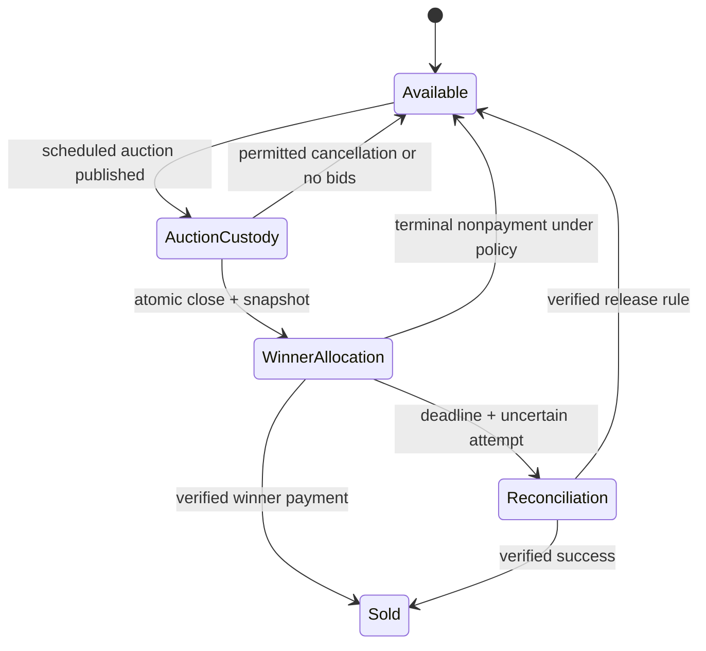
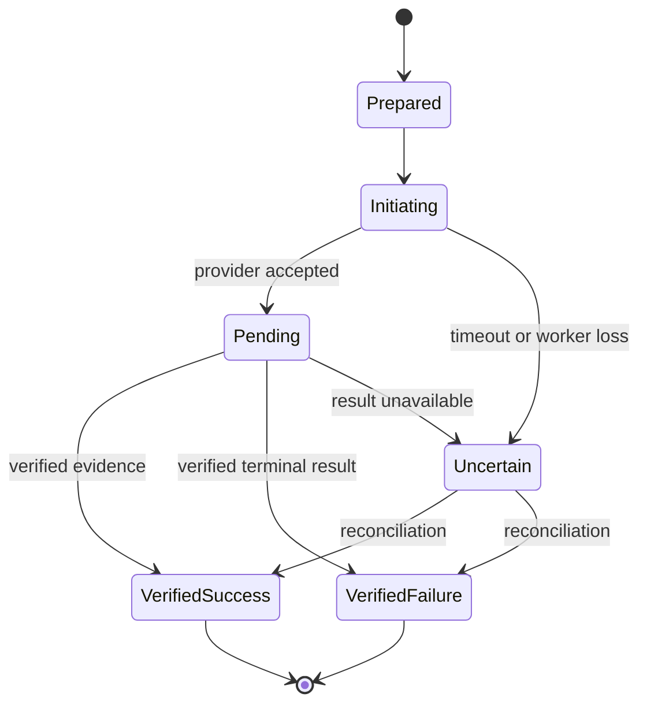

# Transaction and data contract refinement

Design revision 2, 9 October 2026. This specification resolves six omissions found by the separate Avalon planning reviewer. It specifies behavior to implement and verify later; it is not a migration, API implementation, provider guarantee or financial policy approval. When an earlier outline conflicts with this document, this refinement takes precedence in the design proposal.

## Common authority and locking contract

PostgreSQL is the sole durable authority for stock, checkout obligations, offer acceptance and bid order. Public search, Next.js page cache, realtime messages and timers are projections. Every mutation derives its actor from the server session/service identity; client fields cannot assign role, user or shop authority.

Transactions that touch existing rows follow this proposed lock order: **shop sale gate -> checkout/financial obligation roots in ID order -> stock records in ID order -> auctions in ID order -> offer threads in ID order -> payment/refund/payout attempt records**. Discover immutable resource relationships first, then lock; if relationships or versions changed, restart through a bounded retry or return conflict. A command must not lock an auction first and later its stock. New rows created by the transaction are not competing pre-existing roots. Seller stock edits lock the same stock and reject active custody; they cannot bypass it with a separate 'sold elsewhere' path.

Use short transactions, bounded lock waits and consistent ordering. Database row locks protect cooperating writers; correctness requires every write path to honor this contract. [PostgreSQL locking guidance](https://www.postgresql.org/docs/current/explicit-locking.html) explains row-lock behavior and deadlocks. Row `CHECK` constraints enforce local nonnegative values, while cross-row allocation/ledger totals need guarded transactional writes and commit validation; [PostgreSQL constraints](https://www.postgresql.org/docs/current/ddl-constraints.html) do not make arbitrary cross-row checks safe.

For auction/offer/hold deadlines, sample authoritative decision time **after** acquiring contested locks. Do not use transaction-start time to accept a bid that waited beyond close. PostgreSQL's `CURRENT_TIMESTAMP` is fixed at transaction start, whereas `clock_timestamp()` changes during execution; this distinction is documented in [date/time functions](https://www.postgresql.org/docs/current/functions-datetime.html). Persist the sampled decision time and sequence. UTC is stored; WAT is displayed for Nigerian schedules. Clock monitoring and an outage policy are still required.

## Logical records and invariants

| Record | Minimum design fields | Enforced relationship or invariant |
| --- | --- | --- |
| User / Session | user ID, verified contact state, session expiry/revocation | Server derives actor; seller capability does not replace buyer identity. |
| Shop / Membership | shop ID, owner/member user ID, scope, sale status, version | Membership unique; sale gate prevents new sales on pause/suspension while old orders remain operable. |
| VerificationCase | scope, subject, evidence reference, reviewer, decision/reason, retention class | Sensitive storage separate; status has a defined meaning, not generic 'trusted'. |
| CategorySchemaVersion | category ID, version, required fields, publication state | Immutable version; older listing/order remains readable. |
| ListingVersion | listing ID/version, immutable condition/size/flaws/media, sale mode, policy refs | Buyer acceptance pins exact version; no later overwrite. |
| StockRecord | listing/variant, unit kind, total/available/allocated/sold, version | Different condition/size pieces separate; quantity mutations serialized; no negative count. |
| Allocation | stock ID, quantity, kind, holder root, state, expiry/reconciliation ref | One active allocation for unique piece; quantities bounded by stock. Kind: checkout, accepted offer, auction custody, winner obligation. |
| CheckoutGroup | buyer, seller, origin, version, snapshot, deadline, state, active attempt | Same seller only; fixed cart has many children; accepted offer/auction win dedicated group. |
| CheckoutItem | group, listing version, stock allocation, quantity, apportioned costs | Immutable accepted item; all child holds succeed or all fail. |
| OfferThread / Version | buyer, seller, proposer, recipient, listing version, amount/currency, expiry, status | Only recipient accepts/rejects; only proposer withdraws; counter supersedes prior version. |
| Auction / Bid | stock/custody ID, policy version, close time, bid sequence, bidder, amount | One active auction lifecycle per piece; many historical auctions possible; one terminal result. |
| Order / OrderItem | buyer/seller, accepted checkout snapshot, allocation refs, status | Paid order consumes already-frozen snapshot; listing edit cannot alter it. |
| PaymentAttempt | group, provider/ref, state, generation, amount/currency, evidence | One active or uncertain attempt per obligation; references unique; replacement requires verified terminal failure. |
| RefundIntent | obligation, amount, apportioned item/fee/shipping parts, reason, approval, provider state | Pending plus processed amounts stay within refundable captured amount; initiation is not completion. |
| PayoutIntent | obligation, beneficiary version, amount, release-policy version, approvals, provider state | Atomic release/freeze decision; submission uncertainty prevents blind replacement. |
| DisputeCase | obligation/items, policy version, source, deadline, release barrier, decision/reason | Case acceptance serializes with payout authorization; evidence preserved. |
| LedgerTransaction / Entry | unique effect key, source evidence, currency, debit/credit amounts | Append-only balanced entry group; provider custody is external fact, not ledger label. |
| Shipment / Event | order, route/source, quote, provider ref, event ID/time, proof | Seller assertion is source-labelled; event alone not payout approval. |
| Inbox / Outbox / Audit | unique event/command ID, source, raw evidence digest/ref, aggregate version, trace | At-least-once delivery; idempotent consumers; audit includes actor and decision reason. |

## All-item checkout and early snapshot

The cart is an editable interest list and owns no stock. `CreateCheckoutGroup` accepts bounded listing IDs/quantities, expected versions, destination/quote reference and client command key. It rejects cross-seller or auction items; accepted offers and auction wins enter through dedicated commands. Proposed cart item limit is a configuration decision to measure before release.

Within one transaction, authenticate buyer and sale eligibility, lock every stock row in sorted order, verify each listing version and route/quote, and allocate **every item or none**. Write the group and item allocation rows, frozen snapshot, authoritative deadline and outbox in that same commit. If the second item conflicts, no first-item hold survives. One group expires/reconciles as a unit; a child is not silently dropped after payment begins.

The immutable snapshot is captured **before provider initiation**: item version, title, condition, flaws, measurements, retained media identifiers/digests, seller identity at sale, quantities, currency, item price, discount/accepted-offer source, delivery quote/route, dispatch terms, fee/tax components, total, return/protection-policy versions and confirmation time. Retain linked media under the evidence policy. If terms change before initiation, invalidate the old authorization, show a diff/new total and obtain renewed buyer confirmation. Payment success converts that exact snapshot to the paid order; it never reads the current listing to reconstruct purchased terms.

For a combined same-seller shipment, quote uses total package attributes. Freeze deterministic item/fee/shipping allocation rules for partial refunds; no floating point arithmetic. A paid item cannot be removed from the group's financial history. Customer cancellation/refund applies through explicit order/refund commands.

## Offer actor and acceptance contract

Each offer version has a proposer and intended opposing recipient. Buyer proposes -> seller may accept/reject/counter. Seller counteroffers -> buyer may accept/reject/counter. Proposer can withdraw its active proposal. Counter supersedes the prior proposal; neither party can accept its own terms or an earlier version. System expiry is recorded using server time.

Accept validates current version, recipient identity, contact/shop eligibility, listing mode/version, expiry, destination and stock under the common lock order. It atomically records acceptance, creates a dedicated checkout snapshot/allocation and expires competing proposals where required. If allocation fails, acceptance fails too. A successful acceptance grants only the displayed payment hold, not indefinite ownership. An expired unpaid acceptance releases stock only after payment reconciliation; later purchase needs a new valid agreement or listed-price checkout. Negotiation history stays readable for evidence.

## Auction custody and winner transfer

On publication of a scheduled auction, Inventory creates exclusive **auction custody** for that piece. The listing has no buy-now/offer route. Seller cannot external-sell or edit stock under that custody. A permitted pre-bid cancellation is an explicit audited operation that releases custody before any external-sale adjustment. Once bidding begins, cancellation/extension follows approved policy; no silent mode change.

Bid mutation locks stock then auction, checks custody still valid, samples server time after locks, validates eligible opposing buyer, increment and policy, and appends a sequence. Auction closing uses the same locks and time rule. It transfers custody to one winner checkout obligation, snapshot and payment deadline in a single transaction. Custody never becomes available between close and winner payment. Winner payment consumes the existing allocation; it does not first acquire stock.

No-bid/cancelled/failed-winner release is an explicit state transition. Uncertain winner payment is reconciled before release. Relist or second-chance produces a fresh obligation only after prior custody/payment risk is resolved and under approved policy; runner-up is never auto-charged.

## Payment attempt fence and uncertain initiation

Idempotency is scoped to actor + command + obligation; a repeated key with different body returns conflict. Beyond keys, enforce **one active/uncertain attempt per checkout obligation** and one applied paid-order effect. Different keys do not bypass this fence. For a pending attempt, return its reference/status instead of creating another payable provider transaction. Initiation for expired, released, consumed or reconciliating allocation is denied.

Persist merchant reference, amount/currency and attempt generation before provider call. Provider call occurs outside locks. If the process dies or times out after submission, mark/retain uncertainty and verify using the original reference. If the chosen provider cannot guarantee idempotent initiation or safely resolve an unknown submission, do not blindly resubmit; queue reconciliation/operations. A replacement attempt requires verified terminal failure/cancellation and a still-valid obligation; fence old callbacks by generation and preserve their evidence.

Verified success checks reference, amount, currency, environment/account and effect uniqueness, consumes the same allocations, creates the paid order from the frozen snapshot, and appends ledger/outbox. Additional genuine charges are recorded as **excess-payment liabilities requiring refund**, not ignored merely because the order is already paid. Fulfil once. Provider failures/settlement reversals remain separate events, never overwrite history.

## Payout, dispute and refund race contract

The approved provider/operating model still determines whether conditional payout is feasible. This design does not promise to recall a transfer or recover money the provider has already sent. Distinguish payout **eligible**, **authorized**, **submitting**, **provider pending**, **verified paid**, **failed** and **disputed in flight**.

Case acceptance/refund reservation/payout authorization serialize on the same financial obligation root. Opening an eligible case atomically sets a release barrier; pending refund amount also reduces releasable obligation. Payout authorization rechecks barrier, delivery evidence, policy, amount and beneficiary version. A worker claims the intent in a guarded transaction immediately before submission. If a case wins before claim, submission is blocked. If submission already crossed that point, accept the case anyway, label payout in flight, prevent remaining release, and attempt provider cancellation/reversal **only if supported**. Reconcile the verified result and route any resulting debt/loss to the named finance owner.

Refund capacity is reserved atomically, so total pending plus processed refunds cannot exceed captured refundable amount after approved fee/chargeback adjustments. Partial refunds preserve item/fee/shipping apportionment. Any refund after seller settlement requires an approved seller recovery/platform reserve/liability policy; this is an unresolved owner/provider decision. Each reversal/refund/debt/loss uses new balanced ledger entries with evidence, not edits to prior entries. Never call refund initiated 'money returned'.

## Contract examples as design tables

These are proposed HTTP contracts, not executable API definitions.

| Command | Required body/guards | Outcome |
| --- | --- | --- |
| Create checkout group | listing/version/quantity array, destination/quote, confirmation version; authenticated buyer; single seller; all stocks eligible | Group ID, complete accepted snapshot, expiry, child allocation refs; atomic conflict if any item fails. |
| Accept offer | offer ID/version, expected terms, route confirmation; actor must be recipient | Accepted version + dedicated group or no acceptance on allocation failure. |
| Publish auction | listing/version, approved policy ID, schedule; seller scope; stock eligible | Auction ID + exclusive custody, or conflict. |
| Place bid | auction/version, minor-unit amount/currency, obligation confirmation | Accepted sequence/server time/current minimum/end or stale/closed/too-low error. |
| Initiate payment | group/version + confirmation and idempotency; valid allocation; active-attempt fence | Existing/new provider attempt reference and pending status; no second charge initiation during uncertainty. |
| Open case | order/items, reason, evidence refs; entitlement/deadline | Case + atomic release barrier or explicit policy denial; in-flight payout flagged honestly. |
| Request refund/payout | obligation version, approved amount/beneficiary/policy, distinct approval when required | Durable intent, not provider completion; reconciled status later. |

## Required acceptance additions

Extend T02 with auction publication, first bid and external-sale contention; T03/T04 with two different payment keys during uncertainty and extra confirmed charges; T04/T12 with simultaneous case/refund/payout and submission timeout; T02 with self-accept/cross-recipient/stale offer; T09/T10 with listing/policy/media changes while payment pending; T01 with two-item cart where the second is unavailable and prove neither holds. These remain planned database/provider tests. No runtime acceptance is claimed from this document.
